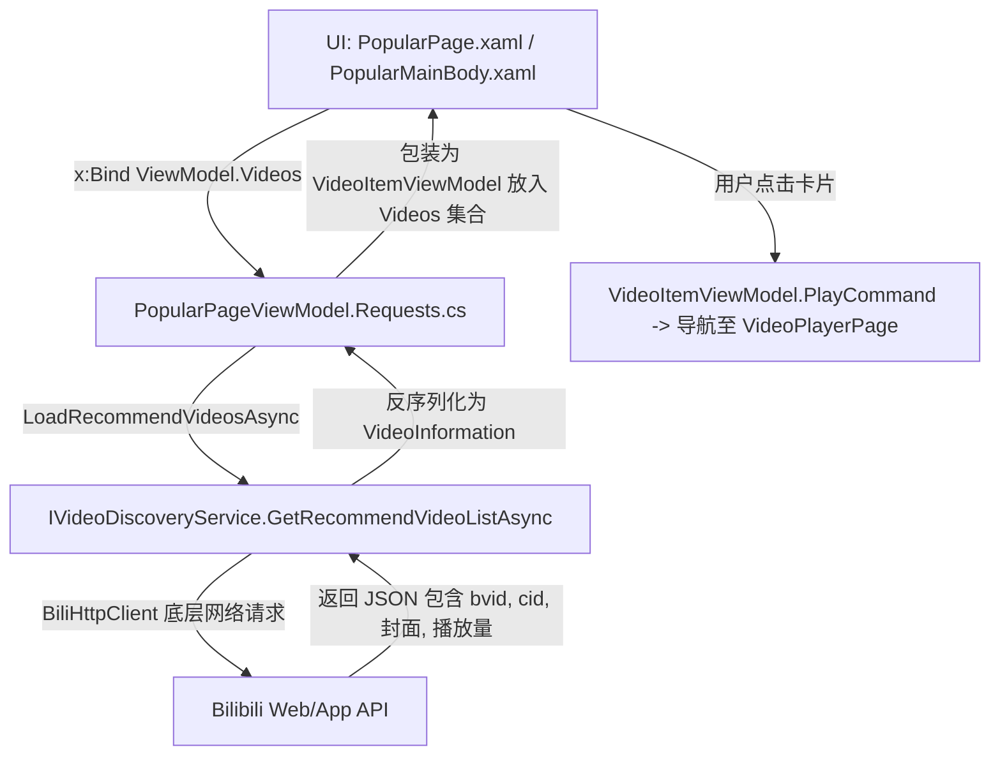
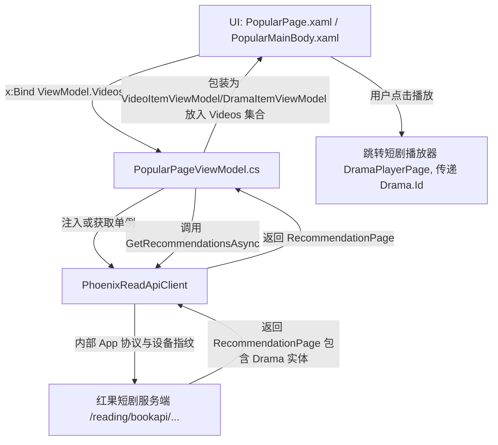

### 一、推荐页：现有 Bilibili 调用链 vs 红果 API 替换链

#### 1. 现有 B 站 API 调用链



- **核心文件**：
  - [PopularPage.xaml](file:///d:/code/WinUI3/PhoenixReadCopilot/src/Desktop/PhoenixReadCopilot/Pages/PopularPage.xaml) / [PopularMainBody.xaml](file:///d:/code/WinUI3/PhoenixReadCopilot/src/Desktop/PhoenixReadCopilot/Controls/Popular/PopularMainBody.xaml)
  - [PopularPageViewModel.cs](file:///d:/code/WinUI3/PhoenixReadCopilot/src/Desktop/PhoenixReadCopilot/ViewModels/View/PopularPageViewModel/PopularPageViewModel.cs)
  - [PopularPageViewModel.Requests.cs](file:///d:/code/WinUI3/PhoenixReadCopilot/src/Desktop/PhoenixReadCopilot/ViewModels/View/PopularPageViewModel/PopularPageViewModel.Requests.cs)（`LoadRecommendVideosAsync`）

#### 2. 改为红果 PhoenixReadApi 的调用链



#### 3. 核心调用代码对比

- **原来（B站）**：
  ```csharp
  var (videos, nextOffset) = await _service.GetRecommendVideoListAsync(_recommendOffset);
  _recommendOffset = nextOffset;
  TryAddVideos(videos, VideoCardStyle.Recommend);
  ```
- **替换后（红果）**：
  ```csharp
  var page = await _apiClient.GetRecommendationsAsync(
      RecommendationGenre.ShortDrama,
      offset: _recommendOffset,
      sessionId: _recommendSessionId,
      seen: _seenDramaIds,
      cancellationToken: ct
  );
  _recommendOffset = page.NextOffset;
  _recommendSessionId = page.SessionId;
  _hasMoreRecommendations = page.HasMore;
  foreach (var item in page.Items)
  {
      if (!string.IsNullOrWhiteSpace(item.Id) && _seenDramaIds.Add(item.Id))
      {
          Videos.Add(new VideoItemViewModel(item, VideoCardStyle.Recommend)); // 传入 Drama 实体
      }
  }
  ```

---

### 二、红果 API 源码参考速查表

在编写代码时，AI 或开发者可直接查阅 [D:\code\C#\PhoenixReadApi](file:///D:/code/C#/PhoenixReadApi) 中的实体类、参考实现与单元测试：

| 功能模块                     | API 接口与客户端方法                                                                                                                                                                                                                                                                                                                                                                                                                                                      | 源码与参考用例位置                                                                                                                                                                                                                                                                                                                                                                                                                                                    | 核心模型类与枚举                                                                                                                                               |
| :--------------------------- | :------------------------------------------------------------------------------------------------------------------------------------------------------------------------------------------------------------------------------------------------------------------------------------------------------------------------------------------------------------------------------------------------------------------------------------------------------------------------ | :-------------------------------------------------------------------------------------------------------------------------------------------------------------------------------------------------------------------------------------------------------------------------------------------------------------------------------------------------------------------------------------------------------------------------------------------------------------------- | :------------------------------------------------------------------------------------------------------------------------------------------------------------- |
| **推荐流与发现流**           | `GetRecommendationsAsync(genre, offset, sessionId, seen)`<br>`GetDiscoverPageAsync(channel, cursor)`<br>`EnumerateRecommendationsAsync(genre, maxPages)`                                                                                                                                                                                                                                                                                                                  | [PhoenixReadApiClient.Search.cs](file:///D:/code/C#/PhoenixReadApi/PhoenixReadApi/PhoenixReadApiClient.Search.cs)<br>[PhoenixReadApiClient.Catalog.cs](file:///D:/code/C#/PhoenixReadApi/PhoenixReadApi/PhoenixReadApiClient.Catalog.cs)<br>[SampleSteps.cs](file:///D:/code/C#/PhoenixReadApi/PhoenixReadApi.Sample/SampleSteps.cs#L170-L197)<br>[SampleFeatureDemos.cs](file:///D:/code/C#/PhoenixReadApi/PhoenixReadApi.Sample/SampleFeatureDemos.cs#L167-L187)    | `RecommendationPage`<br>`Drama`<br>`DiscoverPage`<br>`RecommendationGenre`<br>`DiscoverChannel`                                                                |
| **上新日历 / 预告**          | `GetDailyReleasesAsync(targetDate, offset, sessionId)`（支持指定 `DateOnly?` 目标日期）                                                                                                                                                                                                                                                                                                                                                                                   | [PhoenixReadApiClient.Catalog.cs](file:///D:/code/C#/PhoenixReadApi/PhoenixReadApi/PhoenixReadApiClient.Catalog.cs)<br>[SampleFeatureDemos.cs](file:///D:/code/C#/PhoenixReadApi/PhoenixReadApi.Sample/SampleFeatureDemos.cs#L142-L163)                                                                                                                                                                                                                               | `DailyReleasePage`<br>`DailyReleaseItem`<br>`Drama`                                                                                                            |
| **新剧预约与追更日历**       | `GetUpcomingReservationsAsync(count, offset)`<br>`GetCalendarAsync(count, offset)`<br>`SetReservationAsync(seriesId, active)`<br>`DeleteReservationAsync(seriesId)`                                                                                                                                                                                                                                                                                                       | [PhoenixReadApiClient.Library.cs](file:///D:/code/C#/PhoenixReadApi/PhoenixReadApi/PhoenixReadApiClient.Library.cs)<br>[DiscoveryAndReservationTests.cs](file:///D:/code/C#/PhoenixReadApi/PhoenixReadApi.Tests/DiscoveryAndReservationTests.cs)                                                                                                                                                                                                                      | `ReservationPage`<br>`Reservation`<br>`PhoenixOperationResult`                                                                                                 |
| **找剧多维筛选**             | `GetShortDramaFilterPanelAsync(genre)`<br>`FilterShortDramasAsync(query)`<br>`GetTagCategoriesAsync()`<br>`GetTagDramaPageAsync(tagItemId, sort, offset, count)`                                                                                                                                                                                                                                                                                                          | [PhoenixReadApiClient.Catalog.cs](file:///D:/code/C#/PhoenixReadApi/PhoenixReadApi/PhoenixReadApiClient.Catalog.cs)<br>[SampleFeatureDemos.cs](file:///D:/code/C#/PhoenixReadApi/PhoenixReadApi.Sample/SampleFeatureDemos.cs#L28-L110)<br>[CatalogTests.cs](file:///D:/code/C#/PhoenixReadApi/PhoenixReadApi.Tests/CatalogTests.cs)                                                                                                                                   | `ShortDramaFilterRow`<br>`ShortDramaFilterQuery`<br>`ShortDramaFilterPage`<br>`TagCategoryGroup`<br>`TagDramaPage`<br>`ShortDramaGenre`<br>`TagDramaSortOrder` |
| **排行榜单**                 | `GetShortDramaLeaderboardAsync(category, board, offset, sessionId, seenIds)`<br>`GetActorLeaderboardAsync(offset, sessionId)`                                                                                                                                                                                                                                                                                                                                             | [PhoenixReadApiClient.Catalog.cs](file:///D:/code/C#/PhoenixReadApi/PhoenixReadApi/PhoenixReadApiClient.Catalog.cs)<br>[SampleFeatureDemos.cs](file:///D:/code/C#/PhoenixReadApi/PhoenixReadApi.Sample/SampleFeatureDemos.cs#L115-L137)                                                                                                                                                                                                                               | `ShortDramaLeaderboardPage`<br>`ActorLeaderboardPage`<br>`ActorLeaderboardItem`<br>`ShortDramaLeaderboardCategory`<br>`ShortDramaLeaderboardBoard`             |
| **剧集详情、合集与播放解析** | `GetDramaDetailsAsync(seriesId)`<br>`ResolveMediaAsync(seriesId, videoId)`<br>`GetDramaSeasonsAsync(seriesId)` / `GetAlbumAsync(albumId)`<br>`GetSeriesRecommendationsAsync(seriesId)`<br>`GetBatchDramaDetailsWithEpisodesAsync(seriesIds)`                                                                                                                                                                                                                              | [PhoenixReadApiClient.Details.cs](file:///D:/code/C#/PhoenixReadApi/PhoenixReadApi/PhoenixReadApiClient.Details.cs)<br>[PhoenixReadApiClient.Playback.cs](file:///D:/code/C#/PhoenixReadApi/PhoenixReadApi/PhoenixReadApiClient.Playback.cs)<br>[SampleSteps.cs](file:///D:/code/C#/PhoenixReadApi/PhoenixReadApi.Sample/SampleSteps.cs#L210-L235)<br>[DetailsAndPlaybackTests.cs](file:///D:/code/C#/PhoenixReadApi/PhoenixReadApi.Tests/DetailsAndPlaybackTests.cs) | `DramaDetails`<br>`Episode`<br>`PlaybackMedia`（含 `DecryptionKey` 与 `Referer`）<br>`DramaAlbum`<br>`DramaSeason`<br>`DramaRelatedRecommendations`            |
| **弹幕与评论互动**           | `GetDanmakuAsync(seriesId, videoId, startMs, durationMs)`<br>`SendDanmakuAsync(seriesId, videoId, text)`<br>`GetDramaReviewsAsync(seriesId, count, cursor, sort)`<br>`GetEpisodeCommentsAsync(seriesId, videoId, count, cursor, sort)`<br>`GetEpisodeCommentRepliesAsync(commentId, seriesId, videoId, ...)`<br>`SendDramaReviewAsync(seriesId, rating, text)`<br>`SendEpisodeCommentAsync(seriesId, videoId, text)`<br>`SetCommentLikeAsync(commentId, groupId, active)` | [PhoenixReadApiClient.Comments.cs](file:///D:/code/C#/PhoenixReadApi/PhoenixReadApi/PhoenixReadApiClient.Comments.cs)<br>[SampleSteps.cs](file:///D:/code/C#/PhoenixReadApi/PhoenixReadApi.Sample/SampleSteps.cs#L238-L250)<br>[CommentsAndDanmakuTests.cs](file:///D:/code/C#/PhoenixReadApi/PhoenixReadApi.Tests/CommentsAndDanmakuTests.cs)                                                                                                                        | `DanmakuPage`<br>`DanmakuItem`<br>`CommentPage`<br>`DramaComment`<br>`CommentReplyPage`<br>`CommentSortOrder`<br>`PhoenixOperationResult`                      |
| **书架、历史与进度上报**     | `GetHistoryAsync(count, offset)`<br>`DeleteHistoryAsync(seriesId, videoId)`<br>`ReportProgressAsync(update)`（注意时间单位为毫秒）<br>`GetReadProgressForAsync(seriesOrVideoIds)`<br>`GetFavoritesAsync(count, offset)`<br>`SetFavoriteAsync(seriesId, videoId, active)`                                                                                                                                                                                                  | [PhoenixReadApiClient.Library.cs](file:///D:/code/C#/PhoenixReadApi/PhoenixReadApi/PhoenixReadApiClient.Library.cs)<br>[LibraryTests.cs](file:///D:/code/C#/PhoenixReadApi/PhoenixReadApi.Tests/LibraryTests.cs)                                                                                                                                                                                                                                                      | `ReadHistoryPage`<br>`ReadHistoryEntry`<br>`ProgressUpdate`（毫秒级）<br>`ReadProgressPage`<br>`ReadProgress`<br>`DramaPage`                                   |
| **搜索、热搜与联想**         | `SearchAsync(keyword / query)`（支持多 Tab 如短剧、原著小说、演职员）<br>`GetSuggestionsAsync(keyword, maxResults)`<br>`GetSearchCuesAsync()`<br>`GetHotSearchAsync()`                                                                                                                                                                                                                                                                                                    | [PhoenixReadApiClient.Search.cs](file:///D:/code/C#/PhoenixReadApi/PhoenixReadApi/PhoenixReadApiClient.Search.cs)<br>[SampleFeatureDemos.cs](file:///D:/code/C#/PhoenixReadApi/PhoenixReadApi.Sample/SampleFeatureDemos.cs#L232-L280)<br>[SearchAndRecommendationTests.cs](file:///D:/code/C#/PhoenixReadApi/PhoenixReadApi.Tests/SearchAndRecommendationTests.cs)                                                                                                    | `SearchResult`<br>`SearchQuery`<br>`SearchSuggestion`<br>`HotSearch`<br>`SearchTab`<br>`Novel`<br>`User`                                                       |
| **账号登录与会话管理**       | `CreateQrCodeLoginAsync()`<br>`CheckQrCodeStatusAsync(token)`<br>`SendVerificationCodeAsync(phoneNumber)`<br>`LoginAsync(phoneNumber, code)`<br>`ValidateSessionAsync()`<br>`GetCurrentUserInfoAsync()`<br>`Logout()`                                                                                                                                                                                                                                                     | [PhoenixReadApiClient.Authentication.cs](file:///D:/code/C#/PhoenixReadApi/PhoenixReadApi/PhoenixReadApiClient.Authentication.cs)<br>[AuthenticationTests.cs](file:///D:/code/C#/PhoenixReadApi/PhoenixReadApi.Tests/AuthenticationTests.cs)                                                                                                                                                                                                                          | `QrCodeLoginSession`<br>`QrCodeCheckResult`<br>`VerificationCodeResult`<br>`AuthenticatedUser`<br>`CurrentUserInfo`                                            |
| **演职员与用户主页**         | `GetUserProfileAsync(userId / credit)`<br>`GetUserRelatedDramasAsync(userId, count, cursor)`<br>`GetUserActivitiesAsync(userId, count, cursor)`                                                                                                                                                                                                                                                                                                                           | [PhoenixReadApiClient.Users.cs](file:///D:/code/C#/PhoenixReadApi/PhoenixReadApi/PhoenixReadApiClient.Users.cs)<br>[UserTests.cs](file:///D:/code/C#/PhoenixReadApi/PhoenixReadApi.Tests/UserTests.cs)                                                                                                                                                                                                                                                                | `UserProfile`<br>`UserDramaPage`<br>`UserActivityPage`<br>`DramaCredit`                                                                                        |

---

### 三、供 AI 执行的详细重构计划（Migration Playbook）

下面这份计划书是按 AI Agent 逐步执行的要求制定的，任务分工明确、依赖顺序严谨：

````markdown
# PhoenixReadCopilot 迁移为红果短剧端到端改造计划

## 0. 前置基准与红果客户端注入 (Phase 0)

- [x] **双轨并存服务注册 (DI)**：
  - **切勿在此时移除旧版 B 站服务**（否则未迁移的几十个 ViewModel 将因缺少依赖直接编译报错或启动闪退）；
  - 采用“**双轨并存、逐步绞杀替换**”策略：在保留现有注册的同时，向 `ServiceHelper.cs` 中**新增** `PhoenixReadApiClient` 单例注册：
    - 配置持久化会话路径至 `Path.Combine(PathHelper.AuthFolderPath, "phoenix_session.json")`；
    - 可选配置通用超时（如 25s）与重试次数；
- [x] **验证编译基准**：
  - 执行 `dotnet build src/Desktop/PhoenixReadCopilot.UI/PhoenixReadCopilot.UI.csproj -p:Platform=x64 -c Debug` 确保基准顺利通过，随时可调试。

---

## 1. 第一阶段：推荐页改造 (Phase 1 - 突破口)

- [x] **数据源对接**：
  - 修改 `PopularPageViewModel.Requests.cs` 中的 `LoadRecommendVideosAsync`：
    - 调用 `PhoenixReadApiClient.GetRecommendationsAsync(RecommendationGenre.ShortDrama, ...)`。
    - 保存游标 `NextOffset`、`SessionId` 和已看列表 `_seenIds`，支持瀑布流触底继续拉取。
- [x] **卡片排版微调**：
  - 在卡片控件展示短剧的 `Title`、`Score` (评分)、`EpisodeCount` (总集数) 及 `Tags`。
- [x] **冒烟验证**：
  - 编译并启动应用，验证推荐流能否正常拉取并以海报瀑布流平滑渲染。

---

## 2. 第二阶段：播放内核解密与选集播放链路 (Phase 2 - 核心闭环) [已完成]

- [x] **FFmpegInteropX 注入 CENC 密钥与直链请求头**：
  - 修改 `FFmpegPlayerViewModel.Overrides.cs` 与 `PlayerViewModelBase.Properties.cs`：
    - 废弃生成 B 站 DASH XML 和启动本地 HTTP Server 的复杂逻辑；
    - 直接接收从 `ResolveMediaAsync(seriesId, videoId)` 解析出的 `PlaybackMedia` 对象列表（包含 1080P/720P/480P 等多清晰度规格）；
    - 检查 `PlaybackMedia.DecryptionKey`，若非空，为 FFmpegOptions 注入 AES-128 CENC 解密密钥：
      ```csharp
      config.FFmpegOptions["decryption_key"] = media.DecryptionKey;
      ```
    - 注入红果防盗链 Referer：
      ```csharp
      if (!string.IsNullOrEmpty(CustomReferer))
      {
          config.FFmpegOptions["referer"] = CustomReferer;
          config.FFmpegOptions["headers"] = $"Referer: {CustomReferer}\r\n";
      }
      ```
    - 支持备用直链容灾（若主直链加载失败回退至 `media.BackupUrl`）；
- [x] **统一短剧播放链路 (VideoPlayerPageViewModel 全面接入红果 API)**：
  - 尽量少改界面，复用现有播放页布局；
  - 构造函数注入 `PhoenixReadApiClient` 与 `DramaReviewSectionDetailViewModel`；
  - 调用 `client.GetDramaDetailsAsync(seriesId)` 加载剧集元数据与分集列表；
  - 调用 `client.ResolveMediaAsync(seriesId, videoId)` 获取可用清晰度列表 `IReadOnlyList<PlaybackMedia>`（支持不同画质切换且保持进度）；
  - 播放进度上报：调用 `client.ReportProgressAsync(new ProgressUpdate { SeriesId = ..., VideoId = ..., EpisodeNumber = ..., CurrentPositionMs = ..., DurationMs = ... })`；
  - 信息区交互：
    - 【点赞】分集：调用 `client.SetDramaEpisodeLikeAsync(seriesId, videoId, state)`；
    - 【收藏】整剧：调用 `client.SetFavoriteAsync(seriesId, videoId, state)`；
    - 【分享】：调用 `client.CreateShareLinkAsync(seriesId, videoId)` 生成短剧分享短链并复制到剪贴板；
    - 【制作名单】：增加制作名单 ListView，展示主创人员圆形头像、角色及关注按钮（调用 `client.SetFollowAsync`）；
  - 分集列表：删除“仅显示序号”ToggleSwitch，默认直接使用序号网格视图；
  - 剧评 Tab：整部剧一份，模仿评论 Tab 风格，显示总评分、RatingControl 及发布剧评输入框；
  - 未登录状态控制：发送弹幕、剧评、评论、回复的 TextBox 处于 Disable 状态并给出友好提示；
  - 内置下载引擎：移除 BBDown，直接调用 `ResolveMediaAsync` 提取直链与 CENC 解密密钥，利用 ffmpeg 命令行完成无损解密转存与弹幕封面下载；
  - 专属关联推荐好剧：调用 `client.GetSeriesRecommendationsAsync(seriesId)` 加载关联推荐列表。

---

## 3. 第三阶段：三大特色页面重塑 (Phase 3 - 视觉与业务对标) [已完成]

### 3.1 动漫页 ➔ 上新日历页 (NewDramaCalendarPage)

- [x] **页面定位与路由**：将原 `AnimePage` 重新命名/定义为 `NewDramaCalendarPage`（上新日历）。
- [x] **日期条**：
  - 左侧时间表（复用现在时间选择器）：支持前后多天日期切换（如前 7 天已上线、今天、未来 7 天待播，具体日期以函数返回为准）。
- [x] **API 接入与逻辑拆分**：
  - **上新日历 Tab**：
    - 调用 `client.GetDailyReleasesAsync(targetDate, offset, sessionId)`，targetDate 传入 null 时可获取到可用的所有日期；
    - 传入选中的 `DateOnly` 目标日期，展示当天上线及预告作品；
    - 单项展示：剧名、海报、上线状态标签（`item.IsOnline`）、预告看点（`item.Note`）、总集数及一键直达播放；

### 3.2 影视页 ➔ 找剧 / 多维筛选页 (DramaFilterPage)

- [x] **页面定位与路由**：将原 `CinemaPage` 重新命名/定义为 `DramaFilterPage`（找剧筛选），电影、电视剧、纪录片 切换Tab 可以删除，只留其中一个 Page 进行复用。
- [x] **多维动态条件矩阵（主筛选器，复用现在左侧的筛选）**：
  - 调用 `client.GetShortDramaFilterPanelAsync(ShortDramaGenre.ShortPlay)`，动态拉取体裁、主题、设定、角色、状态、排序等多维标签ComboBox（`ShortDramaFilterRow`）；
  - 标签选中联动：用户选中各标签时，组装 `ShortDramaFilterQuery`（设置 `Genre`、`Selections` 键值集合与 `Offset = 0`）；
  - 调用 `client.FilterShortDramasAsync(query)` 分页检索短剧并展示结果（`ShortDramaFilterPage`）。

### 3.3 流行页面原分区排行榜和全区排行榜 ➔ 排行榜模块

- [x] **页面定位与重塑**：打造红果短剧全套榜单与演员看板体系。
- [x] **分类 Tab 与榜单栏**：
  - 左侧分类 Tab（`ShortDramaLeaderboardCategory`）：全部 (`All`)、真人剧 (`Human`)、漫剧 (`Comic`)、AI剧 (`Ai`)、系列剧 (`Series`)；
  - 顶部细分榜单类型（`ShortDramaLeaderboardBoard`）：默认/推荐榜 (`Default`)、热播榜 (`HotPlay`)、新剧榜 (`NewRelease`)、热搜榜 (`HotSearch`) 等；
  - 独立演员榜：左侧新增【演员排行榜】Tab及页面。
- [x] **API 接入**：
  - 短剧榜单：调用 `client.GetShortDramaLeaderboardAsync(category, board, offset, sessionId, seenIds)`，展示榜单标题（`leaderboard.BoardTitle`）、名次、剧名、评分（`Score`）、热度值（`Heat`）、看点短评（`Remark`）；
  - 演员榜单：调用 client.GetActorLeaderboardAsync(offset, sessionId)，展示名次（Position）、演员名、人气值（Popularity）、代表作（RepresentativeWork）以及排名升降趋势（Trend）；点击演员卡片可跳转该演员主页。

---

## 4. 第四阶段：交互、搜索与用户中心 (Phase 4)

- [ ] **全局搜索与智能联想 (SearchPageViewModel)**：
  - 搜索框下拉实时联想：调用 `client.GetSuggestionsAsync(keyword, maxResults: 8)`；
  - 搜索看板与热搜热榜：调用 `client.GetHotSearchAsync()`，展示“猜你想搜”与短剧/漫剧热搜榜单；
  - 搜索：
    - 短剧检索：调用 `client.SearchAsync(keyword)`，结果映射为 `SearchResult.Dramas`；
- [ ] **个人追剧与播放历史**：
  - 追剧收藏：调用 `client.GetFavoritesAsync(count, offset)` 获取收藏列表，调用 `client.SetFavoriteAsync(seriesId, videoId, active)` 添加/移除收藏；
  - 观看历史：调用 `client.GetHistoryAsync(count, offset)` 获取 `ReadHistoryPage`（记录包含上次播放集数 `EpisodeNumber` 与毫秒进度 `CurrentPositionMs`）；
  - 历史记录删除：调用 `client.DeleteHistoryAsync(seriesId, videoId)`；
- [ ] **演职员与创作者主页 (UserProfilePageViewModel)**：
  - VideoOperationPanel 的制作名单点击演职员署名（`DramaCredit`）时，调用 `client.GetUserProfileAsync(credit)` 打开主页；
  - 分页加载该创作者参与的短剧：调用 `client.GetUserRelatedDramasAsync(userId, count, cursor)`；
  - 分页加载创作者动态：调用 `client.GetUserActivitiesAsync(userId, count, cursor)`。
- [ ] **扫码与短信登录 (LoginDialog / ProfileViewModel)**：
  - 网页扫码登录：调用 `client.CreateQrCodeLoginAsync()` 获取二维码 Base64/图片，轮询 `client.CheckQrCodeStatusAsync(token)`，认证成功自动持久化至本地；
  - 短信验证码登录：调用 `client.SendVerificationCodeAsync(phoneNumber)` 发送验证码，调用 `client.LoginAsync(phoneNumber, code)` 完成登录；
  - 会话有效性与用户信息：启动时调用 `client.ValidateSessionAsync()`，若有效调用 `client.GetCurrentUserInfoAsync()` 恢复头像、昵称；退出时调用 `client.Logout()`。

---

## 5. 第五阶段：收尾清理与包瘦身 (Phase 5)

- [ ] 移除 `Assets/BBDown`、`Assets/Dash*.xml` 以及原 B 站专栏 (Article)、动态 (Moment)、私信 (Message)、音频 (Audio) 等无关废弃模块；
- [ ] 确认所有页面与 ViewModel 已完全解耦后，在 `GlobalDependencies.cs` 中彻底移除 `AddBiliClient()` 等全部旧版 B 站服务注册；
- [ ] 从 `Directory.Packages.props` 中移除未引用的 `Richasy.BiliKernel.*` NuGet 包；
- [ ] 全局搜索清理遗留的 `Bili` 命名空间与硬编码资源，确保干净无死角。
````

---

### 四、下一步行动建议

当前 **Phase 0（客户端 DI 注入）** 与 **Phase 1（推荐页改造）** 已经完成并通过验证。接下来应当集中攻坚 **Phase 2（播放内核解密与选集播放链路）**：

1. 改造 `FFmpegPlayerViewModel.Overrides.cs`，接入 `PlaybackMedia` 的直链、Referer 头与 `DecryptionKey` CENC 解密；
2. 建立 `DramaPlayerPageViewModel` 系列分部类，打通从推荐流点击卡片到进入播放器、获取分集列表、换集播放及毫秒级进度上报的完整业务闭环。

