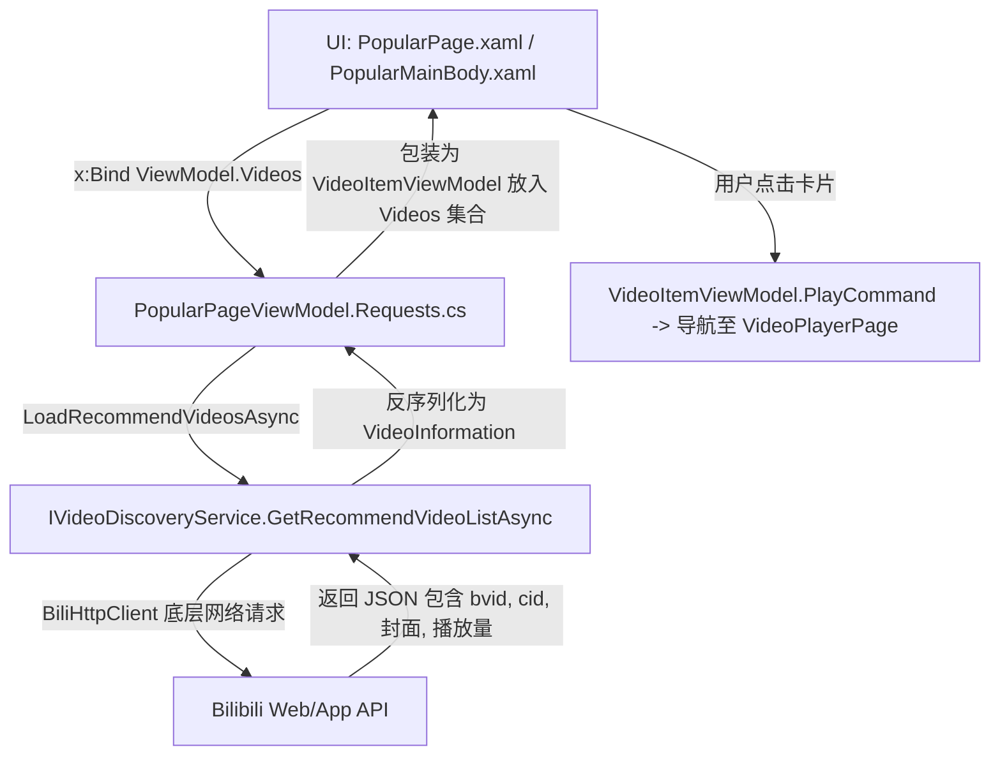
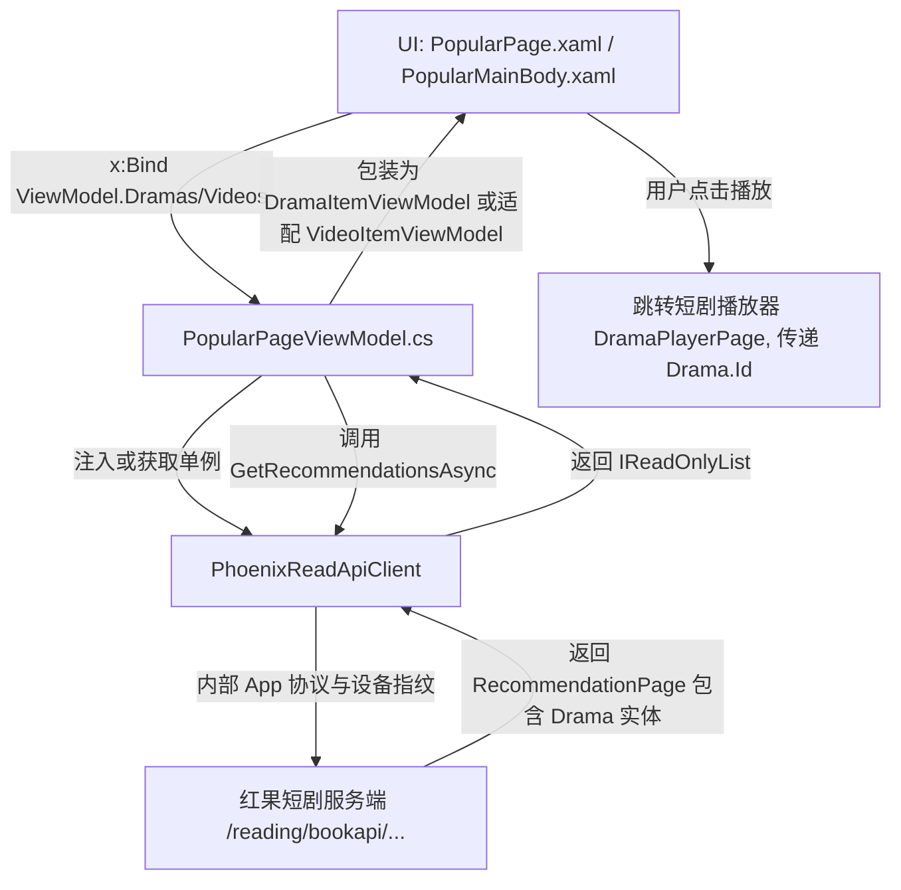

### 一、推荐页：现有 Bilibili 调用链 vs 红果 API 替换链

#### 1. 现有 B 站 API 调用链

- **核心文件**：
  - [PopularPage.xaml](d:/code/WinUI3/PhoenixReadCopilot/src/Desktop/PhoenixReadCopilot.UI/Pages/PopularPage.xaml) / [PopularMainBody.xaml](d:/code/WinUI3/PhoenixReadCopilot/src/Desktop/PhoenixReadCopilot.UI/Controls/Popular/PopularMainBody.xaml)
  - [PopularPageViewModel.cs](d:/code/WinUI3/PhoenixReadCopilot/src/Desktop/PhoenixReadCopilot.UI/ViewModels/View/PopularPageViewModel/PopularPageViewModel.cs)
  - [PopularPageViewModel.Requests.cs](d:/code/WinUI3/PhoenixReadCopilot/src/Desktop/PhoenixReadCopilot.UI/ViewModels/View/PopularPageViewModel/PopularPageViewModel.Requests.cs)（第 14~26 行 `LoadRecommendVideosAsync`）

#### 2. 改为红果 PhoenixReadApi 的调用链


#### 3. 核心调用代码对比
- **原来（B站）**：
  ```csharp
  var (videos, nextOffset) = await _service.GetRecommendVideoListAsync(_recommendOffset);
  _recommendOffset = nextOffset;
  TryAddVideos(videos, VideoCardStyle.Recommend);
  ```
- **替换后（红果）**：
  ```csharp
  var page = await _apiClient.GetRecommendationsAsync(
      RecommendationGenre.ShortDrama,
      offset: _recommendOffset,
      sessionId: _sessionId,
      seen: _seenIds,
      cancellationToken: ct
  );
  _recommendOffset = page.NextOffset;
  _sessionId = page.SessionId;
  foreach (var item in page.Items)
  {
      _seenIds.Add(item.Id);
      Videos.Add(new VideoItemViewModel(item)); // 传入 Drama 实体
  }
  ```

---

### 二、红果 API 源码参考速查表

在编写代码时，AI 或开发者可直接查阅 [D:\code\C#\PhoenixReadApi](D:/code/C#/PhoenixReadApi) 中的实体类、参考实现与单元测试：

| 功能模块 | API 接口文件 | 完整参考用例 / 代码位置 | 核心模型类 |
| :--- | :--- | :--- | :--- |
| **推荐流** | [PhoenixReadApiClient.Search.cs](D:/code/C#/PhoenixReadApi/PhoenixReadApi/PhoenixReadApiClient.Search.cs)<br>`GetRecommendationsAsync` | [SampleSteps.cs](D:/code/C#/PhoenixReadApi/PhoenixReadApi.Sample/SampleSteps.cs#L137-L164) | `RecommendationPage`<br>`Drama` |
| **上新日历 / 预约**<br> | [PhoenixReadApiClient.Library.cs](D:/code/C#/PhoenixReadApi/PhoenixReadApi/PhoenixReadApiClient.Library.cs)<br>`GetUpcomingReservationsAsync`<br>`ReserveDramaAsync` | [SampleFeatureDemos.cs](D:/code/C#/PhoenixReadApi/PhoenixReadApi.Sample/SampleFeatureDemos.cs#L91-L130)<br>[DiscoveryAndReservationTests.cs](D:/code/C#/PhoenixReadApi/PhoenixReadApi.Tests/DiscoveryAndReservationTests.cs) | `ReservationPage`<br>`ReservationItem` |
| **找剧多维筛选**<br> | [PhoenixReadApiClient.Catalog.cs](D:/code/C#/PhoenixReadApi/PhoenixReadApi/PhoenixReadApiClient.Catalog.cs)<br>`GetTagCategoriesAsync`<br>`GetTagDramaPageAsync` | [SampleFeatureDemos.cs](D:/code/C#/PhoenixReadApi/PhoenixReadApi.Sample/SampleFeatureDemos.cs#L20-L66) | `TagCategoryGroup`<br>`TagDramaPage` |
| **排行榜单**<br>| [PhoenixReadApiClient.Library.cs](D:/code/C#/PhoenixReadApi/PhoenixReadApi/PhoenixReadApiClient.Library.cs)<br>`GetFeedCategoriesAsync` | [SampleFeatureDemos.cs](D:/code/C#/PhoenixReadApi/PhoenixReadApi.Sample/SampleFeatureDemos.cs#L67-L90) | `FeedPage`<br>`FeedSection` |
| **分集详情与播放解析** | [PhoenixReadApiClient.Details.cs](D:/code/C#/PhoenixReadApi/PhoenixReadApi/PhoenixReadApiClient.Details.cs)<br>[PhoenixReadApiClient.Playback.cs](D:/code/C#/PhoenixReadApi/PhoenixReadApi/PhoenixReadApiClient.Playback.cs)<br>`ResolveMediaAsync` | [SampleSteps.cs](D:/code/C#/PhoenixReadApi/PhoenixReadApi.Sample/SampleSteps.cs#L180-L240) | `DramaDetails`<br>`PlaybackMedia` (带 `DecryptionKey`) |

---

### 三、编译与运行注意事项（指定 x64 加速）

本项目包含 x86、x64、ARM64 等多种平台配置。**请务必在编译和运行时显式指定 `x64`**，避免多平台混编译或回退至慢速配置：

```powershell
# 1. 快速编译 Desktop 项目 (Debug x64)
dotnet build src/Desktop/PhoenixReadCopilot.UI/PhoenixReadCopilot.UI.csproj -p:Platform=x64 -c Debug

# 2. 或者使用 WinApp CLI 直接运行调试
winapp run -p x64
```
> [!NOTE]
> 本地 NuGet 包 `PhoenixReadApi` 已经添加至 [src/Directory.Packages.props](d:/code/WinUI3/PhoenixReadCopilot/src/Directory.Packages.props) 和 [PhoenixReadCopilot.UI.csproj](d:/code/WinUI3/PhoenixReadCopilot/src/Desktop/PhoenixReadCopilot.UI/PhoenixReadCopilot.UI.csproj)，可以直接使用 `using PhoenixReadApi;`。

---

### 四、供 AI 执行的详细重构计划（Migration Playbook）

下面这份计划书是按 AI Agent 逐步执行的要求制定的，任务分工明确、依赖顺序严谨：

```markdown
# PhoenixReadCopilot 迁移为红果短剧端到端改造计划

## 0. 前置基准与红果客户端注入 (Phase 0)
- [x] **双轨并存服务注册 (DI)**：
  - **切勿在此时移除旧版 B 站服务**（否则未迁移的几十个 ViewModel 将因缺少依赖直接编译报错或启动闪退）；
  - 采用“**双轨并存、逐步绞杀替换**”策略：在保留现有注册的同时，向 `ServiceHelper.cs` 中**新增** `PhoenixReadApiClient` 单例注册：
    - 配置持久化会话路径至 `Path.Combine(PathHelper.AuthFolderPath, "phoenix_session.json")`；
    - 可选配置通用超时（如 25s）与重试次数；
- [x] **验证编译基准**：
  - 执行 `dotnet build src/Desktop/PhoenixReadCopilot.UI/PhoenixReadCopilot.UI.csproj -p:Platform=x64 -c Debug` 确保基准顺利通过，随时可调试。

---

## 1. 第一阶段：推荐页改造 (Phase 1 - 突破口)
- [x] **数据源对接**：
  - 修改 `PopularPageViewModel.Requests.cs` 中的 `LoadRecommendVideosAsync`：
    - 调用 `PhoenixReadApiClient.GetRecommendationsAsync(RecommendationGenre.ShortDrama, ...)`。
    - 保存游标 `NextOffset`、`SessionId` 和已看列表 `_seenIds`，支持瀑布流触底继续拉取。
- [x] **卡片排版微调**：
  - 在卡片控件展示短剧的 `Title`、`Score` (评分)、`EpisodeCount` (总集数) 及 `Tags`。
- [x] **冒烟验证**：
  - 编译并启动应用，验证推荐流能否正常拉取并以海报瀑布流平滑渲染。

---

## 2. 第二阶段：播放内核解密与选集播放链路 (Phase 2 - 核心闭环)
- [ ] **FFmpegInteropX 注入 CENC 密钥**：
  - 修改 `FFmpegPlayerViewModel.Overrides.cs` 中的 `LoadMediaSourceAsync`：
    - 废弃生成 B站 DASH XML (`DashVideoTemplate.xml`) 和启动本地 HTTP Server 的复杂逻辑；
    - 改为直接接收 `PlaybackMedia.Url`；
    - 检查 `PlaybackMedia.DecryptionKey`，若非空，配置：
      ```csharp
      config.FFmpegOptions["decryption_key"] = decryptionKey;
      ```
- [ ] **统一短剧播放页 (DramaPlayerPage)**：
  - 改造原 `PgcPlayerPage` / `VideoPlayerPage` 为短剧专用播放界面；
  - 传入 `seriesId` 调用 `client.GetDramaDetailsAsync(seriesId)`，左侧/抽屉渲染分集列表（第 1 ~ N 集）；
  - 点击分集调用 `client.ResolveMediaAsync(seriesId, videoId)`，取得 `PlaybackMedia` 喂给 FFmpeg 播放内核；
  - 集成自动连播下一集与进度上报 `client.ReportProgressAsync(...)`。

---

## 3. 第三阶段：三大特色页面重塑 (Phase 3 - 视觉与业务对标)

### 3.1 动漫页 ➔ 新剧 / 上新日历页
- [ ] **页面定位**：将原 `AnimePage` 重新命名/定义为 `NewDramaCalendarPage`（上新日历）。
- [ ] **顶部 Tab 与日期条**：
  - 顶部 Tab：【新剧推荐】与【上新日历】；
  - 复用/改造原时间轴横向选择器（`TimelineItemViewModel`），绑定前后 14 天的日期（周日 10/25 ... 今天 11/1 ...）。
- [ ] **API 接入**：
  - 调用 `client.GetUpcomingReservationsAsync(count: 30)`；
  - 按 `ReleaseAtUnixSeconds` 聚合到对应日期分组；
  - 单项展示：剧名、上线状态标签（`已上线` / `待播`）、题材标签、热度、简介、一键播放按钮与预约按钮 (`ReserveDramaAsync`)。

### 3.2 影视页 ➔ 找剧 / 多维筛选页
- [ ] **页面定位**：将原 `CinemaPage` 重新命名/定义为 `DramaFilterPage`（找剧筛选）。
- [ ] **筛选器重塑**：
  - 调用 `client.GetTagCategoriesAsync()`，获取体裁、主题、设定、背景、受众、状态、时间等多维标签树；
  - 顶部/侧边采用 Tag Flow 标签流展开（全部、单选激活高亮）；
  - 标签点击时，调用 `client.GetTagDramaPageAsync(tagItemId, sortType, offset, count)`。
- [ ] **结果呈现**：
  - 下方以卡片网格渲染短剧海报、剧名及评分，支持滚动分页。

### 3.3 流行页面 ➔ 排行榜专页
- [ ] **页面定位**：将原 `PopularPage` 的排行榜模块打造为红果完整榜单体系。
- [ ] **左侧榜单类型栏**：
  - 推荐榜、热播榜、臻果榜、预约榜、新剧榜、热搜榜、追更榜、必看榜、收藏榜。
- [ ] **顶部分类筛选**：
  - 全部、系列剧、漫剧、真人剧、AI剧、演员。
- [ ] **API 接入**：
  - 调用 `client.GetFeedCategoriesAsync()`，按 `FeedSection.Title` 提取对应榜单数据；
  - 右侧列表展示排名序号（TOP 1/2/3 突出显示）、海报、剧名、季度/集数标签、主演、热度、简介及【播放】/【详情】按钮。

---

## 4. 第四阶段：交互、搜索与用户中心 (Phase 4)
- [ ] **搜索与联想**：
  - 改造 `SearchPageViewModel`，接入 `client.SearchAsync(keyword)` 与 `client.GetSuggestionsAsync(keyword)`。
- [ ] **书架（追剧与历史）**：
  - 接入 `client.GetFavoritesAsync()`（追剧）与 `client.GetHistoryAsync()`（历史记录），支持删除和同步进度。
- [ ] **扫码与短信登录**：
  - 改造登录窗口，接入 `client.CreateQrCodeLoginAsync()` / `CheckQrCodeStatusAsync()` 及短信验证码登录。
- [ ] **分集弹幕接入**：
  - 编写适配层，将 `DanmakuPage.Items` 映射至 `Danmaku.Core`。

---

## 5. 第五阶段：收尾清理与包瘦身 (Phase 5)
- [ ] 移除 `Assets/BBDown`、`Assets/Dash*.xml` 以及原 B 站专栏 (Article)、动态 (Moment)、私信 (Message) 等无用模块。
- [ ] 确认所有页面与 ViewModel 已完全解耦后，在 `GlobalDependencies.cs` 中彻底移除 `AddBiliClient()` 等全部旧版 B 站服务注册。
- [ ] 从 `Directory.Packages.props` 中移除未引用的 `Richasy.BiliKernel.*` NuGet 包。
- [ ] 全局搜索清理遗留的 `Bili` 命名空间与硬编码资源。
```

---

如果你准备开始实施，我们可以立即启动 **Phase 0 与 Phase 1**：先把单例客户端在 `GlobalDependencies.cs` 中注册好，然后改造 `PopularPageViewModel.Requests.cs`，让红果短剧推荐流在你的本地界面上跑起来！随时告诉我何时开始。